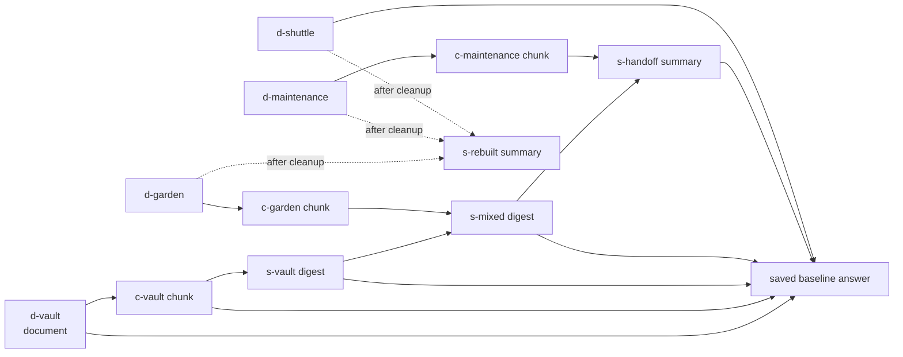

# GhostCache

**Gone from the source. Still in the machine.**

GhostCache is a small local testbed. It shows how an AI assistant can still know something from a document after that document was deleted, and how to clean up properly.

When an assistant reads a document, the app often makes copies of it, such as search chunks, summaries, handoff notes and saved answers. Deleting the original file does not delete those copies. If a later question retrieves one of them, the information comes back. GhostCache lets you:

1. put a fictional secret in a document,
2. watch it spread into chunks, summaries and a saved answer,
3. delete only the original and see the secret still come back,
4. follow the provenance graph to every copy and clean them all up,
5. rebuild useful mixed summaries from the documents that are still there,
6. check that the secret is gone from the assistant's managed memory, while facts that should stay are still answerable.

This is a controlled demonstration, not a claim that every retrieval-augmented (RAG) system has this bug. The source-only deletion is **deliberately broken** inside GhostCache as a comparison. Tracking dependencies and invalidating caches are established techniques. A well-built RAG app may already do this correctly.

## How it fits "Ghost in the Machine"

The theme of DEV Hacktoberfest Week 4 accepts spooky interpretations. GhostCache treats a deleted document as a haunting: the source is gone, but its traces keep coming back through the machine. The graph shows real data dependencies, so the ghost can be traced and laid to rest. The UI does not just give a chatbot a spooky voice. GhostCache does not use the remembrance or ofrenda reading of the theme.

## Status at a glance

| Area | Status |
| --- | --- |
| Local fixture and live-Gemma experiment, browser UI, provenance cleanup | **Implemented** |
| Automated tests | **62 tests pass** under Python 3.12.6 with Node 22 on PATH (rerun on October 27, 2026 after the T-A2–T-A4 UI fixes; 7 are UI contract tests, 6 of which skip without Node; see [TESTING.md](TESTING.md)) |
| Saved evaluations | One fixture report and **one** live Gemma report, each 10/10 checks ([results/](results/)) |
| GitHub Actions workflow | **Configured, not yet run on GitHub.** Its commands pass locally. No repository exists yet. |
| Sentry, Render, .tech domain, Backboard, Browserbase | **Planned, not implemented** |
| ElevenLabs, Entire | **Optional, not started** |
| Public repository, deployment, video, DEV submission | **Not created** |

## What is implemented

- **Five-document fictional corpus.** Each reset generates a fresh `MOTH-…` passphrase (from `secrets.token_hex(6)`) and builds 14 artifacts: 5 documents, 5 chunks, 3 summaries and 1 saved answer.
- **SQLite provenance DAG.** Every generated artifact records *every* artifact given to it as context as a parent. Original source IDs come from those parents and are never supplied by the caller.
- **Two deletion policies:**
  - **Source-only (broken control).** Empties the document body, replaces its title with `Withdrawn document` and leaves its derived copies active.
  - **Cascade cleanup.** In one transaction, empties the bodies of the source and every descendant. Titles are replaced with `Withdrawn document` or `Purged <kind>`, and content-free tombstones and edges are kept. It then rebuilds one summary from the surviving original documents.
- **Lexical retrieval** with up to six context artifacts per answer. After cleanup it also skips anything that depends on a withdrawn source.
- **Two providers:**
  - **Fixture mode:** deterministic string rules with no model call.
  - **Live mode:** local Gemma (`gemma4:e2b-it-qat` by default) through Ollama at `http://127.0.0.1:11434`.
  - Live mode never silently falls back to fixture output.
- **Checks:** an eight-check interactive verification in the UI, and a ten-check end-to-end CLI evaluation that saves a JSON report.
- **Single-page browser UI** with these parts:
  - the five guided steps,
  - a provenance graph,
  - an artifact inspector,
  - a question box with shortcuts,
  - answer citations and timing/token info,
  - the check results,
  - a local event ledger.

## Important limitations

- **Application-managed memory only.** Cleanup covers GhostCache's own SQLite title/body fields, the provenance it recorded, and its retrieval and answer paths. It is **not** model-weight unlearning, and it does not securely erase SQLite pages, journals, disk blocks or backups.
- **The evaluator keeps the marker on purpose.** The expected marker stays in `Experiment.scenario`. It is returned by `GET /api/state` (as `scenario.canary`) even after cleanup, and appears in saved reports and screenshots. Do not say the secret disappears from the whole app, API, browser or disk.
- **Bounded, exact-match checks.** The checks look for one literal marker across four fixed questions. They do not prove that every paraphrase or inference is gone.
- **One live run is not a rate.** The single saved live run does not establish how often Gemma (or any model) succeeds.
- **The summary prompt keeps the secret on purpose.** It explicitly asks the model to preserve the passphrase, which builds a known propagation path. GhostCache does not measure natural leakage.
- **Fictional data only.** It has no document upload, no connector for other RAG systems, and has not been tested with real sensitive documents.
- **Local only.** The server is single-user and localhost-only. It must not be exposed unchanged as a shared public service (see [architecture.md](architecture.md#security-boundaries)).
- **Known UI and code inconsistencies** are listed in [architecture.md](architecture.md#known-discrepancies-between-code-ui-and-earlier-docs) and [tasks.md](tasks.md#a-consistency-and-hardening). Example: the UI has no dedicated display for the `storage_failed` stage.

## Stack and prerequisites

| Need | Detail |
| --- | --- |
| Python | `>=3.12` (from `pyproject.toml`). Verified with **Python 3.12.6** at `/Library/Frameworks/Python.framework/Versions/3.12/bin/python3.12`. The Mac's default `python3` is 3.15.0, which has **not** been tested. |
| Python packages | None. Uses only the standard library (`sqlite3`, `http.server`, `urllib`, `unittest`). |
| Front end | Plain HTML, CSS and JavaScript in `web/`. No build step or npm install. |
| Live mode only | [Ollama](https://ollama.com) running locally, with the model pulled (`ollama list` should show `gemma4:e2b-it-qat`, about 4.3 GB). |
| Optional | Node.js, only used for `node --check web/app.js`. |

## Run it (fixture mode)

> **Warning:** starting the server, and every successful **Seed** or **Reset**, **replaces the contents** of the demo database (default `.local/assistant.sqlite`) with a freshly seeded experiment. Never point `--database` at a SQLite file you want to keep. Restarting does not resume an earlier experiment.
>
> A reset is seeded completely in memory first. Only then is it copied into the database file in place, using SQLite's online backup, so no other file is created or swapped. If seeding or the copy fails (for example, a live model error), the previous experiment stays current, the error is shown, and nothing partial is published. On disk:
>
> - **An existing file keeps its exact bytes.** This holds for a previous GhostCache database, for an unrelated SQLite file and for a file that is not a database. The file is opened without creating any tables, and an aborted copy is rolled back.
> - **A file the failed attempt created is deleted**, along with its `-journal`.
> - **One exception.** On the first reset that targets a file, if the copy completes but the write check that follows it fails, the file already holds the new experiment. The server reports the error and stays on its empty placeholder; the next reset reopens the file.
>
> Crashes and power loss during a copy are not covered. If the restored database cannot be verified as unchanged and writable, the server does not keep serving it: the experiment is cleared, the reset returns HTTP 503 ("Experiment storage could not be restored; reset to recover."), and the next reset recovers. See [DECISIONS.md](DECISIONS.md) D-20.

From this directory:

```sh
python3.12 -m ghostcache serve --port 8765
```

Open <http://127.0.0.1:8765>. Fixture mode is the default and needs no model, network or API key. The page labels it as a deterministic simulation.

If something is already serving that port, use that page or choose another `--port`. Do not start a second server on the same port.

## Run it with local Gemma (live mode)

```sh
ollama list                     # confirm gemma4:e2b-it-qat is installed
# start `ollama serve` in another terminal only if Ollama is not already running
python3.12 -m ghostcache serve --port 8765 --mode live --model gemma4:e2b-it-qat
```

You can also switch to live mode from the page's **Run mode** menu once the model shows as available. Changing mode starts a fresh experiment.

Live seeding makes four model calls (three summaries and the saved baseline answer). The first call took about 81 s in the saved run; the cause of that delay has not been separately measured.

To use a different installed model, pass `--model` or set `GHOSTCACHE_MODEL` (see [.env.example](.env.example)). If Ollama is missing, the model errors, or its response is malformed (not a JSON object with `text` and supplied-context `citations`), live mode reports the error: HTTP 502 in the UI, or a failed report with exit status `1` from the CLI. It never substitutes fixture text. Connection problems are reported only as a fixed category, such as "Local model call failed (connection failed)." The underlying error text is never shown.

## Demonstration workflow (browser)

1. **Seed the archive.** Builds the five documents, chunks, three summaries and one saved answer, with a new marker.
2. **Ask for the private detail.** The answer shows the marker. Click its citations to inspect the artifacts. The answer trace lists the context the provider was given ("Context: d-vault, c-vault, …"), which is also what the saved answer records as its parents.
3. **Delete just the source.** `d-vault` is emptied and renamed `Withdrawn document`. In this guided fixture sequence, six descendants stay active and stale: the seeded five plus the extra answer saved in step 2. A warning explains that this is deliberate. The minimal CLI evaluation has five because its additional probes use `persist=False`.
4. **Look for the echo.** Asks the reworded question "Which access phrase opens the observatory vault?", the same paraphrase the CLI evaluation uses. The marker comes back from the surviving copies.
5. **Clean up the whole trail.** The source and every descendant are emptied and tombstoned, and a replacement summary is rebuilt from surviving source documents.
6. **Verify the cleanup.** Runs eight checks: stored content, four retrieval probes, both secret questions, and two facts that must survive (roof garden `07:40` and reading room `Lantern Hall`).

The inspector shows each artifact's body, status, parents and original roots. The visible ledger shows operations and timings; token counts appear in the answer trace and, when available, in event/API/report data. Generated answer text may be saved as an extra conversation artifact when it has valid context; the question text itself is not stored in that artifact. Answers using withdrawn roots during the broken-control stage, and answers with no context, are not saved. Interactive artifact counts can therefore differ from the saved CLI run.

## Reproduce the tests and evaluations

Write new reports to **new filenames**. Do not overwrite the recorded evidence in `results/fixture.json` and `results/live-gemma.json`.

```sh
python3.12 -m unittest discover -s tests -v
python3.12 -m ghostcache evaluate --mode fixture --output results/fixture-new-run.json
python3.12 -m ghostcache evaluate --mode live --model gemma4:e2b-it-qat --output results/live-gemma-new-run.json
```

Each evaluation uses a fresh in-memory database, separate from the UI database. It prints a short JSON summary and exits `0` only if all ten checks pass, otherwise `1`. A saved report contains the evaluator marker, stage audits, every answer and the event timings. See [TESTING.md](TESTING.md) and [EVALUATION.md](EVALUATION.md).

## Evidence recorded so far

| Evidence | What it shows |
| --- | --- |
| [results/fixture.json](results/fixture.json) | Fixture run, 10/10 checks. Deterministic, no model call. |
| [results/live-gemma.json](results/live-gemma.json) | One live run with `gemma4:e2b-it-qat`, 10/10 checks. 11 model calls, 130,650 ms summed call time, 3,209 input and 677 output tokens. |
| [results/ghostcache-ui-desktop.jpg](results/ghostcache-ui-desktop.jpg), [results/ghostcache-ui-mobile.jpg](results/ghostcache-ui-mobile.jpg) | Screenshots from a fixture-mode browser session, taken at different moments. Not a Browserbase run. |

Both reports show the same stage pattern:

| Stage | Rows | Active | Stale active | Rows with marker |
| --- | ---: | ---: | ---: | ---: |
| Initial | 14 | 14 | 0 | 6 |
| After source-only deletion | 14 | 13 | 5 | 5 |
| After cascade and rebuild | 15 | 9 | 0 | 0 |

The reports have no full date or environment metadata. Their event timestamps are time-of-day only.

## How cleanup works



- **Recorded parents.** The saved baseline answer's parents are the six artifacts that lexical retrieval returned for the vault question, so they include `d-shuttle`.
- **What cascade cleanup removes.** It walks every descendant of `d-vault`: `c-vault`, `s-vault`, `s-mixed`, `s-handoff` and the saved answer.
- **Survivors.** Unrelated artifacts and the independent `d-archive`, which also names Lantern Hall, stay active.
- **Rebuild.** The new summary is built from the surviving *original documents* behind the invalidated mixed content. It never reuses the old mixed prose.

For full details see [architecture.md](architecture.md).

## Prize-category readiness (DEV Hacktoberfest Week 4)

This shows readiness **for each category, not entries made**. Only list a category in the submission after real use and evidence exist. One person can win at most one prize in this challenge. Full plan: [CATEGORIES.md](CATEGORIES.md). Task list: [tasks.md](tasks.md).

| Target | Status |
| --- | --- |
| Best Use of Gemma | **Implemented**, one live 10/10 run saved |
| Best Use of GitHub Copilot (the official description includes GitHub Actions) | **Configured locally**, no hosted run yet. Do not claim Copilot wrote this code. |
| Best Use of Sentry Agent Tracing | Planned |
| Best Use of Render | Planned |
| Best Use of a .tech Domain | Planned; whether the domain qualifies under the Hacktoberfest promo is **unverified** |
| Best Use of Backboard | Planned |
| Best Use of Browserbase | Stretch goal |
| ElevenLabs, Entire | Optional, not started |

## Documentation

- [PRD.md](PRD.md): problem, users, requirements and success measures
- [architecture.md](architecture.md): current design, data model, deletion lifecycle, and proposed future integrations
- [TESTING.md](TESTING.md): how to verify, and what the evidence does and does not show
- [EVALUATION.md](EVALUATION.md): evaluation protocol and how to read the checks
- [DECISIONS.md](DECISIONS.md): decision records
- [tasks.md](tasks.md): ordered remaining work with acceptance criteria
- [AGENTS.md](AGENTS.md): instructions for coding agents
- [CATEGORIES.md](CATEGORIES.md): category plan, free-tier limits and evidence needed
- [.env.example](.env.example): the one supported environment variable

The detailed project handoff (`context.md`) sits in the parent workspace, outside this application directory.

## Prior work

- [Stale RAG vs. expensive RAG: how to cache RAG context without serving outdated answers](https://dev.to/vectorlinklabs/stale-rag-vs-expensive-rag-how-to-cache-rag-context-without-serving-outdated-answers-335f), by `vectorlinklabs`: established source-aware invalidation and lazy rebuilding.
- [Where retrieval assistants leak: the title, the summary and the cache](https://dev.to/fusionaldev/where-retrieval-assistants-leak-the-title-the-summary-and-the-cache-4po4), by `fusionaldev`: why checking only raw documents or final answers is not enough.

GhostCache makes this failure and its cleanup visible in a small experiment you can inspect.

## License

App code: [MIT](LICENSE), © 2026 GhostCache contributors. Gemma, Ollama and any external services have their own licenses and terms. Gemma is open-weight; its weights are not MIT-licensed.
