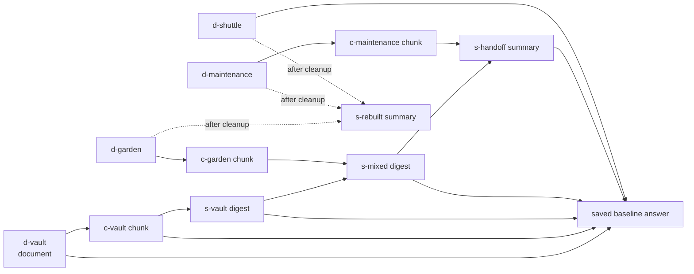

# GhostCache

**Gone from the source. Still in the machine.**

GhostCache is a small local testbed. It shows how an AI assistant can still know something from a document after that document was deleted, and how to clean up properly.

When an assistant reads a document, the app often makes copies of it, such as search chunks, summaries, handoff notes and saved answers. Deleting the original file does not delete those copies. If a later question retrieves one of them, the information comes back. GhostCache lets you:

1. put a fictional secret in a document,
2. watch it spread into chunks, summaries and a saved answer,
3. delete only the original and see the secret still come back,
4. follow the provenance graph to every copy and clean them all up,
5. rebuild useful mixed summaries from the documents that are still there,
6. check that the secret is gone from the assistant's managed memory, while facts that should stay are still answerable.

This is a controlled demonstration, not a claim that every retrieval-augmented (RAG) system has this bug. The source-only deletion is **deliberately broken** inside GhostCache as a comparison. Tracking dependencies and invalidating caches are established techniques. A well-built RAG app may already do this correctly.

## How it fits "Ghost in the Machine"

The theme of DEV Hacktoberfest Week 4 accepts spooky interpretations. GhostCache treats a deleted document as a haunting: the source is gone, but its traces keep coming back through the machine. The graph shows real data dependencies, so the ghost can be traced and laid to rest. The UI does not just give a chatbot a spooky voice. GhostCache does not use the remembrance or ofrenda reading of the theme.

## Status at a glance

| Area | Status |
| --- | --- |
| Local fixture and live-Gemma experiment, browser UI, provenance cleanup | **Implemented** |
| Automated tests | **91 tests pass** under Python 3.12.6 with Node 22 on PATH (rerun on October 28, 2026 after adding the public walkthrough, T-E2). 7 are UI contract tests, 6 of which skip without Node. 9 are telemetry tests, 6 of which skip without the optional `sentry-sdk`; all 91 ran with it in `.venv`. 20 are walkthrough tests, 1 of which skips without Node. See [TESTING.md](TESTING.md) |
| Saved evaluations | One fixture report and **three** live Gemma reports (October 27, and cold and warm runs on October 28), each 10/10 checks ([results/](results/)) |
| GitHub Actions workflow | **Passed on GitHub:** [run #1](https://github.com/bipul724/GhostCache/actions/runs/40570510382) on October 28, 2026 (push of `6e767ee`): 62 tests, none skipped, and a fresh fixture evaluation that passed. [Run #3](https://github.com/bipul724/GhostCache/actions/runs/40573873485) (push of `172ccb4`) also passed, and its uploaded fixture report was downloaded and inspected: 10 of 10 checks, `passed: true`. |
| Sentry Agent Tracing | **Implemented** (optional, metadata only, off unless `GHOSTCACHE_SENTRY_DSN` is set; see [below](#optional-sentry-tracing)). **Real traces captured on October 28, 2026** from one fixture and two live evaluations, with two findings; see [What the real traces showed](#what-the-real-traces-showed). Sent from a 14-day Sentry Business trial with no payment method; the runs used 120 of its 100M spans. |
| Public recorded walkthrough | **Implemented and tested locally; Render configuration prepared ([render.yaml](render.yaml)); not deployed yet.** A static page in [site/](site/) built from the recorded live reports, with no inference. See [Public recorded walkthrough](#public-recorded-walkthrough). Render is used only to host it; it is not a submission category. |
| Prize categories | **Entering three:** Gemma, GitHub (through Actions) and Sentry Agent Tracing. The .tech domain, Backboard, Browserbase, ElevenLabs and Entire categories were dropped on October 28, 2026 and are not entered ([DECISIONS.md](DECISIONS.md) D-14). |
| Public repository | **Created:** [bipul724/GhostCache](https://github.com/bipul724/GhostCache) (public, MIT) |
| Deployment, video, DEV submission | **Not created** (the walkthrough's Render deployment is prepared but not done) |

## What is implemented

- **Five-document fictional corpus.** Each reset generates a fresh `MOTH-…` passphrase (from `secrets.token_hex(6)`) and builds 14 artifacts: 5 documents, 5 chunks, 3 summaries and 1 saved answer.
- **SQLite provenance DAG.** Every generated artifact records *every* artifact given to it as context as a parent. Original source IDs come from those parents and are never supplied by the caller.
- **Two deletion policies:**
  - **Source-only (broken control).** Empties the document body, replaces its title with `Withdrawn document` and leaves its derived copies active.
  - **Cascade cleanup.** In one transaction, empties the bodies of the source and every descendant. Titles are replaced with `Withdrawn document` or `Purged <kind>`, and content-free tombstones and edges are kept. It then rebuilds one summary from the surviving original documents.
- **Lexical retrieval** with up to six context artifacts per answer. After cleanup it also skips anything that depends on a withdrawn source.
- **Two providers:**
  - **Fixture mode:** deterministic string rules with no model call.
  - **Live mode:** local Gemma (`gemma4:e2b-it-qat` by default) through Ollama at `http://127.0.0.1:11434`.
  - Live mode never silently falls back to fixture output.
- **Checks:** an eight-check interactive verification in the UI, and a ten-check end-to-end CLI evaluation that saves a JSON report.
- **Single-page browser UI** with these parts:
  - the five guided steps,
  - a provenance graph,
  - an artifact inspector,
  - a question box with shortcuts,
  - answer citations and timing/token info,
  - the check results,
  - a local event ledger.

## Important limitations

- **Application-managed memory only.** Cleanup covers GhostCache's own SQLite title/body fields, the provenance it recorded, and its retrieval and answer paths. It is **not** model-weight unlearning, and it does not securely erase SQLite pages, journals, disk blocks or backups.
- **The evaluator keeps the marker on purpose.** The expected marker stays in `Experiment.scenario`. It is returned by `GET /api/state` (as `scenario.canary`) even after cleanup, and appears in saved reports and screenshots. Do not say the secret disappears from the whole app, API, browser or disk.
- **Bounded, exact-match checks.** The checks look for one literal marker across four fixed questions. They do not prove that every paraphrase or inference is gone.
- **One live run is not a rate.** The single saved live run does not establish how often Gemma (or any model) succeeds.
- **The summary prompt keeps the secret on purpose.** It explicitly asks the model to preserve the passphrase, which builds a known propagation path. GhostCache does not measure natural leakage.
- **Fictional data only.** It has no document upload, no connector for other RAG systems, and has not been tested with real sensitive documents.
- **Local only.** The server is single-user and localhost-only. It must not be exposed unchanged as a shared public service (see [architecture.md](architecture.md#security-boundaries)). The public walkthrough is a separate static page of recorded results: it runs no model and cannot answer new questions.
- **Known UI and code inconsistencies** are listed in [architecture.md](architecture.md#known-discrepancies-between-code-ui-and-earlier-docs) and [tasks.md](tasks.md#a-consistency-and-hardening). Example: the UI has no dedicated display for the `storage_failed` stage.

## Stack and prerequisites

| Need | Detail |
| --- | --- |
| Python | `>=3.12` (from `pyproject.toml`). Verified with **Python 3.12.6** at `/Library/Frameworks/Python.framework/Versions/3.12/bin/python3.12`. The Mac's default `python3` is 3.15.0, which has **not** been tested. |
| Python packages | None required. The core uses only the standard library (`sqlite3`, `http.server`, `urllib`, `unittest`). The optional `sentry` extra (`sentry-sdk==2.72.0`) is needed only for tracing; install it into `.venv`, never the system Python. |
| Front end | Plain HTML, CSS and JavaScript in `web/`. No build step or npm install. |
| Live mode only | [Ollama](https://ollama.com) running locally, with the model pulled (`ollama list` should show `gemma4:e2b-it-qat`, about 4.3 GB). |
| Optional | Node.js, only for the UI contract tests and the syntax checks of `web/app.js` and `site/walkthrough.js`; those tests skip without it. |

## Run it (fixture mode)

> **Warning:** starting the server, and every successful **Seed** or **Reset**, **replaces the contents** of the demo database (default `.local/assistant.sqlite`) with a freshly seeded experiment. Never point `--database` at a SQLite file you want to keep. Restarting does not resume an earlier experiment.
>
> A reset is seeded completely in memory first. Only then is it copied into the database file in place, using SQLite's online backup, so no other file is created or swapped. If seeding or the copy fails (for example, a live model error), the previous experiment stays current, the error is shown, and nothing partial is published. On disk:
>
> - **An existing file keeps its exact bytes.** This holds for a previous GhostCache database, for an unrelated SQLite file and for a file that is not a database. The file is opened without creating any tables, and an aborted copy is rolled back.
> - **A file the failed attempt created is deleted**, along with its `-journal`.
> - **One exception.** On the first reset that targets a file, if the copy completes but the write check that follows it fails, the file already holds the new experiment. The server reports the error and stays on its empty placeholder; the next reset reopens the file.
>
> Crashes and power loss during a copy are not covered. If the restored database cannot be verified as unchanged and writable, the server does not keep serving it: the experiment is cleared, the reset returns HTTP 503 ("Experiment storage could not be restored; reset to recover."), and the next reset recovers. See [DECISIONS.md](DECISIONS.md) D-20.

From this directory:

```sh
python3.12 -m ghostcache serve --port 8765
```

Open <http://127.0.0.1:8765>. Fixture mode is the default and needs no model, network or API key. The page labels it as a deterministic simulation.

If something is already serving that port, use that page or choose another `--port`. Do not start a second server on the same port.

## Run it with local Gemma (live mode)

```sh
ollama list                     # confirm gemma4:e2b-it-qat is installed
# start `ollama serve` in another terminal only if Ollama is not already running
python3.12 -m ghostcache serve --port 8765 --mode live --model gemma4:e2b-it-qat
```

You can also switch to live mode from the page's **Run mode** menu once the model shows as available. Changing mode starts a fresh experiment.

Live seeding makes four model calls (three summaries and the saved baseline answer). The first call took about 81 s in the saved run; the cause of that delay has not been separately measured.

To use a different installed model, pass `--model` or set `GHOSTCACHE_MODEL` (see [.env.example](.env.example)). If Ollama is missing, the model errors, or its response is malformed (not a JSON object with `text` and supplied-context `citations`), live mode reports the error: HTTP 502 in the UI, or a failed report with exit status `1` from the CLI. It never substitutes fixture text. Connection problems are reported only as a fixed category, such as "Local model call failed (connection failed)." The underlying error text is never shown.

## Optional Sentry tracing

Tracing is **off** unless `GHOSTCACHE_SENTRY_DSN` is set. Without it, `sentry_sdk` is never imported and nothing changes. The core stays standard-library only.

```sh
python3.12 -m venv .venv
.venv/bin/python -m pip install "sentry-sdk==2.72.0"     # the optional `sentry` extra
export GHOSTCACHE_SENTRY_DSN="https://<public-key>@<org>.ingest.sentry.io/<project-id>"
.venv/bin/python -m ghostcache evaluate --mode fixture --output results/fixture-traced.json
```

`serve` and `evaluate` print `Sentry tracing enabled (metadata only)` to stderr. The DSN is never printed. If the DSN is set but `sentry-sdk` is not installed, both exit `1` with a fixed message.

- **Traces.** One root transaction per `POST /api/*` request (`GET /api/state` is not traced) and one per `evaluate` run. Inside them: the assistant (`invoke_agent ghostcache-assistant`) with memory search, model call (`chat <model>`) and memory write; the summarizer; reset; deletion (`delete_memory`, with rebuilds nested); and verification.
- **Sent:** operation and span names (fixed strings), the provider and model name, token counts, durations, record counts, synthetic artifact IDs (`d-vault`, `c-vault`, …), the stage and mode, a question kind (`secret`, `paraphrase`, `retained`, `shared` or `custom`), booleans such as `answer_contains_marker`, check counts, and an error's class name and fixed category. A random conversation ID per reset groups an experiment's spans.
- **Never sent:** document text or titles, questions, answers, prompts, the marker, request bodies, the Ollama URL, the machine's hostname or file paths. Every attribute must be in `ALLOWED_KEYS` in [ghostcache/telemetry.py](ghostcache/telemetry.py), and `telemetry.set` rejects anything else. Error events are dropped (traces only), default integrations (automatic HTTP spans, logging, excepthook) are off, and `server_name` is `ghostcache-local`.
- **Verified offline, then with real traces.** `tests/test_telemetry.py` captures envelopes in memory and asserts that no marker, question, document title or body, answer, hostname, home path or Ollama URL appears in them. On October 28, 2026 the user then sent real traces to their own Sentry project (below). Sentry's Agents view reported that the conversations' inputs and outputs weren't captured.

### What the real traces showed

On October 28, 2026 (times IST) the user ran three traced evaluations with `GHOSTCACHE_SENTRY_DSN` set from the git-ignored `.env`. All three passed 10/10 checks.

| Report written | Run | Report | Sentry trace |
| --- | --- | --- | --- |
| 09:10 | fixture | kept outside the repository | a 0.15 ms conversation, no model calls |
| 09:18 | live, `gemma4:e2b-it-qat`; the first evaluation after `ollama serve` was started (**cold**) | [results/sentry-live-cold.json](results/sentry-live-cold.json) | `dd21f76b3293450b84b0ad5ca45961dd` |
| 09:19 | live, same model, straight afterwards with the model still loaded (**warm**) | [results/sentry-live-warm.json](results/sentry-live-warm.json) | `fb1530272ecd481399aa77f95d505dfa` |

Each live trace has the root `ghostcache.evaluate` "evaluate live", 39 spans, release `0.1.0`, environment `local-live` and 0 issues. The traces were sent from a 14-day Sentry Business trial with no payment method on file; all the runs together used 120 of its 100M spans.


**Finding 1: one model call explains most of the cold run's extra time.**

| Span | Cold | Warm |
| --- | ---: | ---: |
| First `chat gemma4:e2b-it-qat` (summarizer, during reset) | 40.45 s | 2.28 s |
| `ghostcache.reset` | 48.20 s | 9.58 s |
| `ghostcache.verify` | 4.99 s | 4.51 s |
| Root `ghostcache.evaluate` | 1.03 min | 22.40 s |

Every later chat span took about 1–3 s in both traces, so that first call accounts for most of the 1.03 min against 22.40 s. This is consistent with Ollama loading the model on the first request after a server start. GhostCache does not record Ollama's `load_duration`, though, so the cause is **inferred, not measured**. Both runs passed 10/10, so the pass/fail result does not show any of this; the trace does.


**Finding 2: the trace shows the source-only leak without exporting content.** In the cold trace, the `invoke_agent ghostcache-assistant` span after the source-only `delete_memory` has `ghostcache.stage: source_only`, `ghostcache.question_kind: paraphrase` and `ghostcache.answer_contains_marker: true`. Its `search_memory` child lists `ghostcache.context_ids`: `c-vault, s-mixed, s-handoff, s-vault, conversation-ac1ed7b44098484690552c629a0b637a, d-garden`. So after the source document was deleted, its derived chunk, three summaries and an earlier saved answer were still retrieved and sent to Gemma. Sentry received only synthetic IDs and a boolean, never the marker or the answer.


**Failures are traced too.** One of the three live attempts that failed at 09:16, before `ollama serve` was started, was inspected: trace `7e075ad683f247d687b59dddbb038ce5`. It has a single span, the root `ghostcache.evaluate` "evaluate live" (9.69 ms), with status `internal_error`, `error.type: ProviderError` and `ghostcache.mode: live`. The run stopped at the Ollama availability check in `Experiment.reset`, before the `ghostcache.reset` span opens, so the trace shows the failure's class but no `ghostcache.error.category`; that attribute is set only on a failed `chat` span. Sentry shows "no associated issue" because GhostCache drops every error event and sends traces only.


More screenshots: [the memory search that returned `c-vault`](results/sentry-c-vault-search.jpg), [the warm trace](results/sentry-warm-trace.jpg) and [the warm first model call, 181 input + 55 output tokens](results/sentry-warm-chat-tokens.jpg). Method, cross-checks and what was not verified: [TESTING.md](TESTING.md), "Real Sentry traces T-D3".

## Public recorded walkthrough

[site/](site/) is a static, read-only walkthrough of the **recorded** live Gemma runs, for people who can't run the app. It says so at the top: *"Recorded local Gemma evaluation — no live inference."* It makes no model call and no `/api/*` request, stores nothing, and deletes nothing. Its only data request is `data/evidence.json` from the same site.

Visitors can:

- pick one of the three recorded live runs (October 28 cold, October 28 warm, October 27);
- step through the five stages, each with the report's audit counts and a memory trail of artifact IDs: the seeded memory, the source-only deletion, the recorded answer that still reveals the marker, the provenance cleanup, and the recorded checks. The step buttons only change the view;
- open the six preset questions and read Gemma's recorded answers, with the context IDs, citations, durations and tokens;
- compare the cold and warm runs' recorded model-call durations.

Everything shown comes from three saved reports: [results/sentry-live-cold.json](results/sentry-live-cold.json), [results/sentry-live-warm.json](results/sentry-live-warm.json) and [results/live-gemma.json](results/live-gemma.json). The reports hold artifact IDs, counts, answers, checks and event timings, not summary or document text, so the page shows no artifact bodies. "From" links are labelled by origin: **recorded** (summary parents in the report's event log), **seed design** (one chunk per document, fixed in `app.py`) or **inferred** (the saved answer's parents, from the order of recorded events). The fixture report is not used. The fictional marker stays visible because these reports are evaluator evidence (see [Important limitations](#important-limitations)).

**Regenerating the data.** [scripts/export_site_data.py](scripts/export_site_data.py) (standard library only) reads exactly those three reports, validates their shape, keeps an allowlist of fields, records each source file's SHA-256, refuses fixture or non-Gemma reports, and writes `site/data/evidence.json` deterministically. As an additional safeguard on that allowlisted output, it refuses text matching selected patterns (certain machine paths, local endpoints such as `127.0.0.1` and the Ollama port, Sentry and credential-like strings, and email addresses). This pattern check is not comprehensive secret detection and does not replace reviewing the public data. It never runs a model.

```sh
python3.12 scripts/export_site_data.py          # rewrite site/data/evidence.json
python3.12 scripts/export_site_data.py --check  # exit 1 if it is out of date (also a unit test)
```

**Preview locally.** Pick a free port (check with `lsof -nP -iTCP:8790 -sTCP:LISTEN`); this does not touch the app, its database or Ollama:

```sh
python3.12 -m http.server 8790 --bind 127.0.0.1 --directory site
```

Then open <http://127.0.0.1:8790>.

**Deploy on Render (static site).** The Blueprint [render.yaml](render.yaml) defines one static site and nothing else: no server, database, worker, model, environment variable or secret. Render publishes only `site/`. Steps for the account owner:

1. Push `main` so that `render.yaml` and `site/` are on GitHub.
2. In the Render Dashboard choose **New → Blueprint**, connect `bipul724/GhostCache`, branch `main`, and apply the `render.yaml` it finds. It creates the static site `ghostcache-walkthrough`.
3. Or create it by hand with **New → Static Site**: repository `bipul724/GhostCache`, branch `main`, root directory blank (the repository root), build command `echo "No build step; site/ is committed static files"`, publish directory `site`. A hand-made site does not get the Blueprint's security headers; add them under the site's **Headers** settings, copying `render.yaml`.
4. After the first deploy, open the `onrender.com` URL Render shows and check:
   - the banner reads "Recorded local Gemma evaluation — no live inference";
   - the run buttons, the five stage buttons and the six question buttons all work;
   - the browser's network panel shows only `style.css`, `walkthrough.js` and `data/evidence.json`;
   - `curl -sI <url>` shows the `Content-Security-Policy` header (Blueprint deploys);
   - `<url>/api/state` returns 404.
5. Record the real URL here and in [tasks.md](tasks.md) (T-E3) only after those checks pass.

Render's documentation describes static sites as free to deploy; bandwidth and build minutes count against the workspace's plan. That was read from the documentation on October 28, 2026, not checked against an account.

## Demonstration workflow (browser)

1. **Seed the archive.** Builds the five documents, chunks, three summaries and one saved answer, with a new marker.
2. **Ask for the private detail.** The answer shows the marker. Click its citations to inspect the artifacts. The answer trace lists the context the provider was given ("Context: d-vault, c-vault, …"), which is also what the saved answer records as its parents.
3. **Delete just the source.** `d-vault` is emptied and renamed `Withdrawn document`. In this guided fixture sequence, six descendants stay active and stale: the seeded five plus the extra answer saved in step 2. A warning explains that this is deliberate. The minimal CLI evaluation has five because its additional probes use `persist=False`.
4. **Look for the echo.** Asks the reworded question "Which access phrase opens the observatory vault?", the same paraphrase the CLI evaluation uses. The marker comes back from the surviving copies.
5. **Clean up the whole trail.** The source and every descendant are emptied and tombstoned, and a replacement summary is rebuilt from surviving source documents.
6. **Verify the cleanup.** Runs eight checks: stored content, four retrieval probes, both secret questions, and two facts that must survive (roof garden `07:40` and reading room `Lantern Hall`).

The inspector shows each artifact's body, status, parents and original roots. The visible ledger shows operations and timings; token counts appear in the answer trace and, when available, in event/API/report data. Generated answer text may be saved as an extra conversation artifact when it has valid context; the question text itself is not stored in that artifact. Answers using withdrawn roots during the broken-control stage, and answers with no context, are not saved. Interactive artifact counts can therefore differ from the saved CLI run.

## Reproduce the tests and evaluations

Write new reports to **new filenames**. Do not overwrite the recorded evidence in `results/fixture.json` and `results/live-gemma.json`.

```sh
python3.12 -m unittest discover -s tests -v
python3.12 -m ghostcache evaluate --mode fixture --output results/fixture-new-run.json
python3.12 -m ghostcache evaluate --mode live --model gemma4:e2b-it-qat --output results/live-gemma-new-run.json
```

Each evaluation uses a fresh in-memory database, separate from the UI database. It prints a short JSON summary and exits `0` only if all ten checks pass, otherwise `1`. A saved report contains the evaluator marker, stage audits, every answer and the event timings. See [TESTING.md](TESTING.md) and [EVALUATION.md](EVALUATION.md).

## Evidence recorded so far

| Evidence | What it shows |
| --- | --- |
| [results/fixture.json](results/fixture.json) | Fixture run, 10/10 checks. Deterministic, no model call. |
| [results/live-gemma.json](results/live-gemma.json) | The first live run (October 27, 2026) with `gemma4:e2b-it-qat`, 10/10 checks. 11 model calls, 130,650 ms summed call time, 3,209 input and 677 output tokens. |
| [results/ghostcache-ui-desktop.jpg](results/ghostcache-ui-desktop.jpg), [results/ghostcache-ui-mobile.jpg](results/ghostcache-ui-mobile.jpg) | Screenshots from a fixture-mode browser session, taken at different moments. Not a Browserbase run. |
| [results/sentry-live-cold.json](results/sentry-live-cold.json), [results/sentry-live-warm.json](results/sentry-live-warm.json) | Two traced live runs with `gemma4:e2b-it-qat` on October 28, 2026, 10/10 checks each. 11 model calls each: 61,325 ms summed call time cold, 22,078 ms warm. |
| Seven `results/sentry-*.jpg` screenshots | Sentry's Agents view, the two live traces and one failed live attempt ([results/sentry-failed-run.jpg](results/sentry-failed-run.jpg)). See [What the real traces showed](#what-the-real-traces-showed). |

All four reports show the same stage pattern:

| Stage | Rows | Active | Stale active | Rows with marker |
| --- | ---: | ---: | ---: | ---: |
| Initial | 14 | 14 | 0 | 6 |
| After source-only deletion | 14 | 13 | 5 | 5 |
| After cascade and rebuild | 15 | 9 | 0 | 0 |

The reports have no full date or environment metadata. Their event timestamps are time-of-day only.

## How cleanup works



- **Recorded parents.** The saved baseline answer's parents are the six artifacts that lexical retrieval returned for the vault question, so they include `d-shuttle`.
- **What cascade cleanup removes.** It walks every descendant of `d-vault`: `c-vault`, `s-vault`, `s-mixed`, `s-handoff` and the saved answer.
- **Survivors.** Unrelated artifacts and the independent `d-archive`, which also names Lantern Hall, stay active.
- **Rebuild.** The new summary is built from the surviving *original documents* behind the invalidated mixed content. It never reuses the old mixed prose.

For full details see [architecture.md](architecture.md).

## Prize-category readiness (DEV Hacktoberfest Week 4)

This shows readiness **for each category, not entries made**. The submission will enter **three** categories: Gemma, GitHub (through Actions) and Sentry. Only list a category in the submission after real use and evidence exist. One person can win at most one prize in this challenge. Full plan: [CATEGORIES.md](CATEGORIES.md). Task list: [tasks.md](tasks.md).

| Target | Status |
| --- | --- |
| Best Use of Gemma | **Implemented**, three live 10/10 runs saved; a recorded walkthrough of them is prepared for public hosting |
| Best Use of GitHub Copilot (the official description includes GitHub Actions) | **Hosted run exists:** [Actions run #1](https://github.com/bipul724/GhostCache/actions/runs/40570510382) passed on October 28, 2026. Do not claim Copilot wrote this code. |
| Best Use of Sentry Agent Tracing | **Real traces captured** on October 28, 2026, with two explained findings ([details](#what-the-real-traces-showed)). |
| Best Use of Render | **Not entered.** Render may host the public walkthrough (prepared, not deployed); entering the category is a separate decision. |
| Best Use of a .tech Domain, Backboard, Browserbase, ElevenLabs, Entire | **Dropped** on October 28, 2026; not entered |

## Documentation

- [PRD.md](PRD.md): problem, users, requirements and success measures
- [architecture.md](architecture.md): current design, data model, deletion lifecycle, and proposed future integrations
- [TESTING.md](TESTING.md): how to verify, and what the evidence does and does not show
- [EVALUATION.md](EVALUATION.md): evaluation protocol and how to read the checks
- [DECISIONS.md](DECISIONS.md): decision records
- [tasks.md](tasks.md): ordered remaining work with acceptance criteria
- [AGENTS.md](AGENTS.md): instructions for coding agents
- [CATEGORIES.md](CATEGORIES.md): category plan, free-tier limits and evidence needed
- [.env.example](.env.example): the supported environment variables
- [render.yaml](render.yaml) and [site/](site/): the public recorded walkthrough and its Render static-site Blueprint (see [above](#public-recorded-walkthrough))

The detailed project handoff (`context.md`) sits in the parent workspace, outside this application directory.

## Prior work

- [Stale RAG vs. expensive RAG: how to cache RAG context without serving outdated answers](https://dev.to/vectorlinklabs/stale-rag-vs-expensive-rag-how-to-cache-rag-context-without-serving-outdated-answers-335f), by `vectorlinklabs`: established source-aware invalidation and lazy rebuilding.
- [Where retrieval assistants leak: the title, the summary and the cache](https://dev.to/fusionaldev/where-retrieval-assistants-leak-the-title-the-summary-and-the-cache-4po4), by `fusionaldev`: why checking only raw documents or final answers is not enough.

GhostCache makes this failure and its cleanup visible in a small experiment you can inspect.

## License

App code: [MIT](LICENSE), © 2026 GhostCache contributors. Gemma, Ollama and any external services have their own licenses and terms. Gemma is open-weight; its weights are not MIT-licensed.
