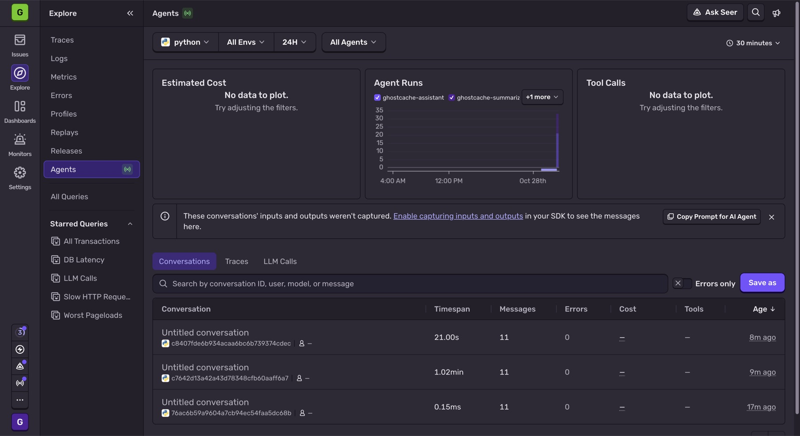
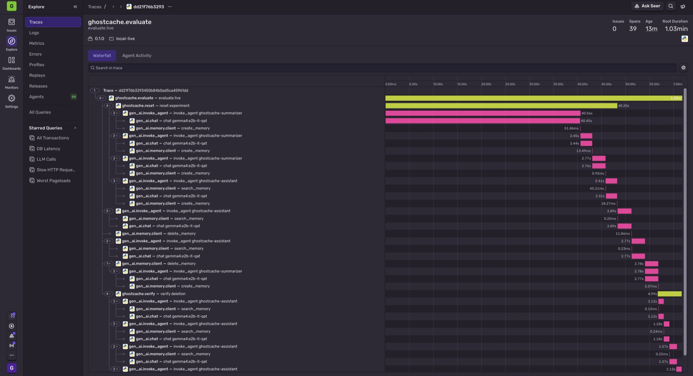
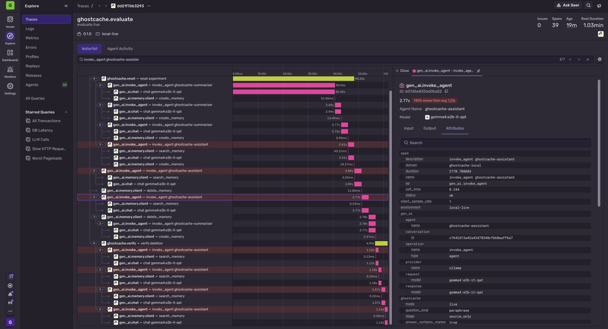
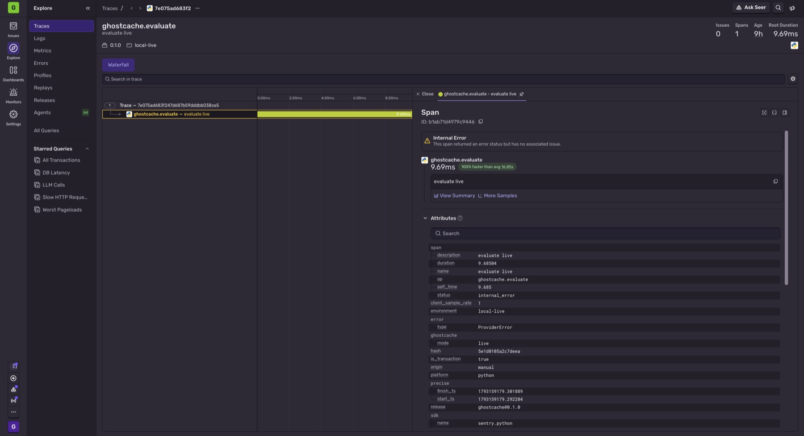
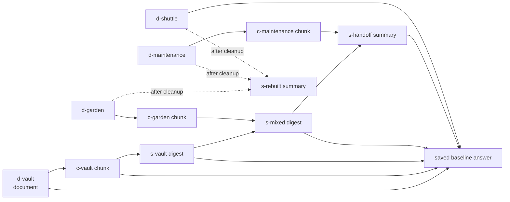

# GhostCache

**Gone from the source. Still in the machine.**

GhostCache is a small local testbed. It shows how an AI assistant can still know something from a document after that document was deleted, and how to clean up properly.

When an assistant reads a document, the app often makes copies of it, such as search chunks, summaries, handoff notes and saved answers. Deleting the original file does not delete those copies. If a later question retrieves one of them, the information comes back. GhostCache lets you:

1. put a fictional secret in a document,
2. watch it spread into chunks, summaries and a saved answer,
3. delete only the original and see the secret still come back,
4. follow the provenance graph to every copy and clean them all up,
5. rebuild useful mixed summaries from the documents that are still there,
6. check that the secret is gone from the assistant's managed memory, while facts that should stay are still answerable.

This is a controlled demonstration, not a claim that every retrieval-augmented (RAG) system has this bug. The source-only deletion is **deliberately broken** inside GhostCache as a comparison. Tracking dependencies and invalidating caches are established techniques. A well-built RAG app may already do this correctly.

## How it fits "Ghost in the Machine"

The theme of DEV Hacktoberfest Week 4 accepts spooky interpretations. GhostCache treats a deleted document as a haunting: the source is gone, but its traces keep coming back through the machine. The graph shows real data dependencies, so the ghost can be traced and laid to rest. The UI does not just give a chatbot a spooky voice. GhostCache does not use the remembrance or ofrenda reading of the theme.

## Status at a glance

**UI content refresh and audit fixes, October 29, 2026 (local; not deployed).** The methodology page now separates current project evidence from recorded model results: the local test suite, hosted Actions evidence, real Sentry findings, Render and custom-domain evidence, five intended categories and the remaining work. The run guide includes optional tracing and current recovery behaviour; public links use the `.tech` address with Render as an alternate. The local lab explains evaluator retention after confirmed cleanup (T-A7). [Verification and new captures](screenshots/ui-content-refresh-2026-10-29/README.md) cover this refresh; the recorded reports and exported JSON are unchanged. A follow-up audit fix makes a failed mode switch return the lab's menu, and the next Reset, to the experiment's confirmed mode; 126 local tests pass ([audit-fix evidence](screenshots/audit-fixes-2026-10-29/README.md)). The public pages' new content reaches the live site only after the owner deploys it (T-E9). *(Later status: these changes were committed and pushed in `00cfb10`, and hosted run #17 on that commit succeeded (see the next table). Their deployment is still unverified, T-E9.)* **October 30, 2026 (local; not deployed):** the methodology page's GitHub Actions entry now reports the archived run #16 and run #17 fixture reports (10/10 each) and keeps the hosted test count unverified; it was checked in a local preview ([evidence](screenshots/ci-evidence-update-2026-10-30/README.md)).

| Area | Status |
| --- | --- |
| Local fixture and live-Gemma experiment, browser UI, provenance cleanup | **Implemented** |
| Automated tests | **126 tests** under Python 3.12.6 with Node v22.23.4 on PATH, rerun after the failed-mode-switch fix on October 29, 2026: `Ran 126 tests … OK` with the optional `sentry-sdk` in `.venv`, and `Ran 126 tests … OK (skipped=6)` with plain `python3.12` (the 6 skips are the SDK telemetry tests). Node is needed by 23 of the 24 UI tests (the twenty-fourth, `test_paraphrase_fallback_matches_backend_question`, is pure Python; the two reconciliation tests check the real server first and then skip their Node half) and by 4 site tests (the script syntax test and three `site/site.js` behaviour cases), so 27 skip without Node: run with `node` removed from PATH, plain `python3.12` gave `OK (skipped=33)` (27 Node plus 6 SDK). *(Earlier counts: 124 tests after the UI content refresh; the 107-test suite run without Node gave `OK (skipped=24)`.)* These are local results, not hosted CI. See [TESTING.md](TESTING.md) |
| Saved evaluations | One fixture report and **three** live Gemma reports (October 27, and cold and warm runs on October 28), each 10/10 checks ([results/](results/)) |
| GitHub Actions workflow | **Passing on GitHub.** [Run #1](https://github.com/bipul724/GhostCache/actions/runs/40570510382) (push of `6e767ee`): 62 tests, none skipped, and a fresh fixture evaluation that passed. [Run #3](https://github.com/bipul724/GhostCache/actions/runs/40573873485)'s uploaded fixture report was downloaded and inspected: 10 of 10 checks, `passed: true`. Seventeen runs existed when last checked (October 29, 2026): sixteen succeeded and run #2 was a cancelled duplicate. [Run #16](https://github.com/bipul724/GhostCache/actions/runs/40867758385) on committed `f66977d` and the latest, [run #17](https://github.com/bipul724/GhostCache/actions/runs/40922048949) on `00cfb10` (which contains the UI content refresh and the failed-mode-switch fix), reported success for every step. Both runs' uploaded fixture reports were later downloaded and inspected: `passed: true`, 10 of 10 checks each ([run #16 evidence](screenshots/hosted-ci-run-16-2026-10-29/README.md), [run #17 evidence](screenshots/hosted-ci-run-17-2026-10-29/README.md)). Their job logs were not read, so no hosted test count is claimed for them; hosted counts exist only for runs #1 and #3 (62 tests each). Runs after #1 were checked through GitHub's public API (step results only). A passing run is not deployment evidence (T-E9). See [TESTING.md](TESTING.md#ci-github-actions) |
| Sentry Agent Tracing | **Implemented** (optional, metadata only, off unless `GHOSTCACHE_SENTRY_DSN` is set; see [below](#optional-sentry-tracing)). **Real traces captured on October 28, 2026** from one fixture and two live evaluations, with two findings; see [What the real traces showed](#what-the-real-traces-showed). Sent from a 14-day Sentry Business trial with no payment method; the runs used 120 of its 100M spans. |
| Public recorded walkthrough | **Deployed on Render on October 28, 2026:** <https://ghostcache-walkthrough.onrender.com/> (Blueprint-managed static site from [render.yaml](render.yaml); initial deployment from commit `8013d01`). **Since October 29, 2026 the same site is also at <https://ghostcache.bipulchamoli.tech/>** ([custom-domain evidence](screenshots/custom-domain-2026-10-29/README.md)). A static site in [site/](site/) built around the recorded live reports, with no inference. See [Public recorded walkthrough](#public-recorded-walkthrough) and [DEPLOYMENT.md](DEPLOYMENT.md). The narrow-screen horizontal overflow found on October 28 (T-E7) was fixed and verified live from commit `2a1ffb0` on October 28–29: the served stylesheet then matched the fixed file byte for byte, and the user's DevTools checks found no overflow from 320 to 1280 px. The later redesign replaced that stylesheet, so it is no longer the one served. A real phone and other browsers are not yet checked (T-E6). **The earlier light "Residual Archive" redesign and its linked favicon are publicly served:** read-only checks on October 29 (the latest at 16:33 UTC, on both addresses) found all 11 public files byte-identical to `site/` at committed `f66977d`, with `/favicon.svg` returning 200 ([latest comparison](screenshots/audit-fixes-2026-10-29/public-served-files.json)). This identifies the served bytes, not Render's built commit. **The new UI content refresh is local and still awaits deployment verification (T-E9).** See [Public recorded walkthrough](#public-recorded-walkthrough). Render only hosts these static files; no inference runs there. Since October 29, 2026, Best Use of Render and Best Use of a .tech Domain are two of the five intended categories (see the next row). |
| Prize categories | **Five intended (October 29, 2026):** Best Use of Gemma, Best Use of GitHub Copilot (through GitHub Actions), Best Use of Sentry Agent Tracing, Best Use of Render and Best Use of a .tech Domain. None is entered until the DEV submission lists it. Eligibility for Render and for .tech is our reading of the official wording, not organizer confirmation ([Render](CATEGORIES.md#best-use-of-render), [.tech](CATEGORIES.md#best-use-of-a-tech-domain)). The .tech promo origin rests on the owner's confirmation; the archived screenshots do not show which code was applied. Earlier, the scope was three categories on October 28, then four with Render on October 29. Backboard, Browserbase, ElevenLabs and Entire were dropped on October 28, 2026 and are not entered ([DECISIONS.md](DECISIONS.md) D-14). |
| Public repository | **Created:** [bipul724/GhostCache](https://github.com/bipul724/GhostCache) (public, MIT) |
| Video, DEV submission | **Not created.** No category entry has been submitted yet; see [Open work](#open-work). |

## What is implemented

- **Five-document fictional corpus.** Each reset generates a fresh `MOTH-…` passphrase (from `secrets.token_hex(6)`) and builds 14 artifacts: 5 documents, 5 chunks, 3 summaries and 1 saved answer.
- **SQLite provenance DAG.** Every generated artifact records *every* artifact given to it as context as a parent, not just the ones the model cites. Model citations are shown to the user but never define lineage. Original source IDs come from those parents and are never supplied by the caller.
- **Two deletion policies:**
  - **Source-only (broken control).** Empties the document body, replaces its title with `Withdrawn document` and leaves its derived copies active.
  - **Cascade cleanup.** In one transaction, empties the bodies of the source and every descendant. Titles are replaced with `Withdrawn document` or `Purged <kind>`, and content-free tombstones and edges are kept. It then rebuilds one summary from the surviving original documents.
- **Lexical retrieval** with up to six context artifacts per answer. After cleanup it also skips anything that depends on a withdrawn source.
- **Two providers:**
  - **Fixture mode:** deterministic string rules with no model call.
  - **Live mode:** local Gemma (`gemma4:e2b-it-qat` by default) through Ollama at `http://127.0.0.1:11434`.
  - Live mode never silently falls back to fixture output.
- **Checks:** an eight-check interactive verification in the UI, and a ten-check end-to-end CLI evaluation that saves a JSON report.
- **Storage:** the local server keeps its experiment in a disposable SQLite file (default `.local/assistant.sqlite`); each CLI evaluation uses a fresh in-memory SQLite database and never touches that file.
- **Optional Sentry tracing** (metadata only) and a **GitHub Actions** workflow; see below.
- **A static recorded walkthrough** of three live runs, published on Render; see below.
- **Single-page browser UI, the local lab** (light theme since October 29, 2026) with these parts:
  - the five guided steps, with reset in the header and the steps panel,
  - a mode banner that names the active mode ("Fixture — deterministic simulation" or "Live Gemma — local model inference") separately from whether a live model is available. If switching mode fails (for example, live seeding returns HTTP 502), the previous experiment stays current and the **Run mode** menu returns to its confirmed mode, so the next **Reset** asks for that mode rather than repeating the refused one,
  - a stage status line with the audit's counts (incomplete deletion, cleanup, a failed rebuild, or unrestorable storage). A failed rebuild is read from the server's current rebuild outcome (`state.rebuild`), kept apart from the 50-event ledger window, so the warning stays after a reload, a repeated cleanup or any number of later events, until a successful reset or a later successful rebuild (D-22). Repeating cleanup does not retry the failed rebuild, because nothing is left to purge; **Reset** starts a fresh experiment. If a cleanup request fails after its purge committed (for example, the rebuilt summary could not be stored), the page reads the server's state back and shows it under the original error,
  - a provenance graph that draws documents, chunks, summaries and saved answers as different shapes with text labels, highlights a selected or hovered artifact's ancestors and descendants, and keeps removed artifacts as content-free tombstones, plus an accessible list view of the same artifacts,
  - an artifact inspector (a collapsible panel on narrow screens),
  - a question box with shortcuts, and answer citations, timing and token info,
  - the check results, grouped,
  - the event ledger.

## Important limitations

- **Application-managed memory only.** Cleanup covers GhostCache's own SQLite title/body fields, the provenance it recorded, and its retrieval and answer paths. It is **not** model-weight unlearning, and it does not securely erase SQLite pages, journals, disk blocks or backups.
- **The evaluator keeps the marker on purpose.** The expected marker stays in `Experiment.scenario`. It is returned by `GET /api/state` (as `scenario.canary`) even after cleanup, and appears in saved reports and screenshots. Do not say the secret disappears from the whole app, API, browser or disk.
- **Bounded, exact-match checks.** The checks look for one literal marker across four fixed questions. They do not prove that every paraphrase or inference is gone.
- **Three live runs are not a rate.** The three saved live runs (one model, one laptop, two days) do not establish how often Gemma, or any model, succeeds.
- **The summary prompt keeps the secret on purpose.** It explicitly asks the model to preserve the passphrase, which builds a known propagation path. GhostCache does not measure natural leakage.
- **Fictional data only.** It has no document upload, no connector for other RAG systems, and has not been tested with real sensitive documents.
- **Local only.** The server is single-user and localhost-only. It must not be exposed unchanged as a shared public service (see [architecture.md](architecture.md#security-boundaries)). The public walkthrough is a separate static page of recorded results: it runs no model and cannot answer new questions.
- **Evaluator retention is visible after confirmed cleanup.** Next to the checks, the local lab says the evaluator still holds the expected marker in `scenario.canary`, returned by `/api/state`, and in saved reports. The note remains visible if the purge finished but rebuilding failed; it is hidden after reset, when storage is unavailable or when server state cannot be confirmed (T-A7). Remaining work is listed in [tasks.md](tasks.md).

## Stack and prerequisites

| Need | Detail |
| --- | --- |
| Python | `>=3.12` (from `pyproject.toml`). Verified with **Python 3.12.6** at `/Library/Frameworks/Python.framework/Versions/3.12/bin/python3.12`. The Mac's default `python3` is 3.15.0, which has **not** been tested. |
| Python packages | None required. The core uses only the standard library (`sqlite3`, `http.server`, `urllib`, `unittest`). The optional `sentry` extra (`sentry-sdk==2.72.0`) is needed only for tracing; install it into `.venv`, never the system Python. |
| Front end | Plain HTML, CSS and JavaScript in `web/`. No build step or npm install. |
| Live mode only | [Ollama](https://ollama.com) running locally, with the model pulled (`ollama list` should show `gemma4:e2b-it-qat`, about 4.3 GB). |
| Optional | Node.js (verified with v22.23.4; no npm packages), only for 23 of the 24 UI tests, the 3 `site/site.js` behaviour tests and the 1 public-site script syntax test (which checks the four `site/*.js` scripts): 27 tests in all, which skip without it. |

## Run it (fixture mode)

> **Warning:** starting the server, and every successful **Seed** or **Reset**, **replaces the contents** of the demo database (default `.local/assistant.sqlite`) with a freshly seeded experiment. Never point `--database` at a SQLite file you want to keep. Restarting does not resume an earlier experiment.
>
> A reset is seeded completely in memory first. Only then is it copied into the database file in place, using SQLite's online backup, so no other file is created or swapped. If seeding or the copy fails (for example, a live model error), the previous experiment stays current, the error is shown, and nothing partial is published. On disk:
>
> - **An existing file keeps its exact bytes.** This holds for a previous GhostCache database, for an unrelated SQLite file and for a file that is not a database. The file is opened without creating any tables, and an aborted copy is rolled back.
> - **A file the failed attempt created is deleted**, along with its `-journal`.
> - **One exception.** On the first reset that targets a file, if the copy completes but the write check that follows it fails, the file already holds the new experiment. The server reports the error and stays on its empty placeholder; the next reset reopens the file.
>
> Crashes and power loss during a copy are not covered. If the restored database cannot be verified as unchanged and writable, the server does not keep serving it: the experiment is cleared, the reset returns HTTP 503 ("Experiment storage could not be restored; reset to recover."), and the next reset recovers. See [DECISIONS.md](DECISIONS.md) D-20.

From this directory:

```sh
python3.12 -m ghostcache serve --port 8765
```

Open <http://127.0.0.1:8765>. Fixture mode is the default. It needs Python 3.12, but no extra Python packages, model, network or API key. The page labels it as a deterministic simulation.

If something is already serving that port, use that page or choose another `--port`. Do not start a second server on the same port.

## Run it with local Gemma (live mode)

```sh
ollama list                     # confirm gemma4:e2b-it-qat is installed
# start `ollama serve` in another terminal only if Ollama is not already running
python3.12 -m ghostcache serve --port 8765 --mode live --model gemma4:e2b-it-qat
```

You can also switch to live mode from the page's **Run mode** menu once the model shows as available. Changing mode starts a fresh experiment.

Live seeding makes four model calls (three summaries and the saved baseline answer). The first call can be slow: 81.2 s in the October 27 run and 40.4 s in the October 28 run that followed an Ollama server start, against 2.3 s in the run straight afterwards (see [What the real traces showed](#what-the-real-traces-showed)). Model loading is the likely cause, but it has not been measured.

To use a different installed model, pass `--model` or set `GHOSTCACHE_MODEL` (see [.env.example](.env.example)). If Ollama is missing, the model errors, or its response is malformed (not a JSON object with `text` and supplied-context `citations`), live mode reports the error: HTTP 502 in the UI, or a failed report with exit status `1` from the CLI. It never substitutes fixture text. Connection problems are reported only as a fixed category, such as "Local model call failed (connection failed)." The underlying error text is never shown.

## Optional Sentry tracing

Tracing is **off** unless `GHOSTCACHE_SENTRY_DSN` is set. Without it, `sentry_sdk` is never imported and nothing changes. The core stays standard-library only.

```sh
python3.12 -m venv .venv
.venv/bin/python -m pip install "sentry-sdk==2.72.0"     # the optional `sentry` extra
export GHOSTCACHE_SENTRY_DSN="https://<public-key>@<org>.ingest.sentry.io/<project-id>"
.venv/bin/python -m ghostcache evaluate --mode fixture --output results/fixture-traced.json
```

`serve` and `evaluate` print `Sentry tracing enabled (metadata only)` to stderr. The DSN is never printed. If the DSN is set but `sentry-sdk` is not installed, both exit `1` with a fixed message.

- **Traces.** One root transaction per `POST /api/*` request (`GET /api/state` is not traced) and one per `evaluate` run. Inside them: the assistant (`invoke_agent ghostcache-assistant`) with memory search, model call (`chat <model>`) and memory write; the summarizer; reset; deletion (`delete_memory`, with rebuilds nested); and verification.
- **Sent:** operation and span names (fixed strings), the provider and model name, token counts, durations, record counts, synthetic artifact IDs (`d-vault`, `c-vault`, …), the stage and mode, a question kind (`secret`, `paraphrase`, `retained`, `shared` or `custom`), booleans such as `answer_contains_marker`, check counts, and an error's class name and fixed category. A random conversation ID per reset groups an experiment's spans.
- **Never sent:** document text or titles, questions, answers, prompts, the marker, request bodies, the Ollama URL, the machine's hostname or file paths. Every attribute must be in `ALLOWED_KEYS` in [ghostcache/telemetry.py](ghostcache/telemetry.py), and `telemetry.set` rejects anything else. Error events are dropped (traces only), default integrations (automatic HTTP spans, logging, excepthook) are off, and `server_name` is `ghostcache-local`.
- **Verified offline, then with real traces.** `tests/test_telemetry.py` captures envelopes in memory and asserts that no marker, question, document title or body, answer, hostname, home path or Ollama URL appears in them. On October 28, 2026 the user then sent real traces to their own Sentry project (below). Sentry's Agents view reported that the conversations' inputs and outputs weren't captured.

### What the real traces showed

On October 28, 2026 (times IST) the user ran three traced evaluations with `GHOSTCACHE_SENTRY_DSN` set from the git-ignored `.env`. All three passed 10/10 checks.

| Report written | Run | Report | Sentry trace |
| --- | --- | --- | --- |
| 09:10 | fixture | kept outside the repository | a 0.15 ms conversation, no model calls |
| 09:18 | live, `gemma4:e2b-it-qat`; the first evaluation after `ollama serve` was started (**cold**) | [results/sentry-live-cold.json](results/sentry-live-cold.json) | `dd21f76b3293450b84b0ad5ca45961dd` |
| 09:19 | live, same model, straight afterwards with the model still loaded (**warm**) | [results/sentry-live-warm.json](results/sentry-live-warm.json) | `fb1530272ecd481399aa77f95d505dfa` |

Each live trace has the root `ghostcache.evaluate` "evaluate live", 39 spans, release `0.1.0`, environment `local-live` and 0 issues. The traces were sent from a 14-day Sentry Business trial with no payment method on file; all the runs together used 120 of its 100M spans.



**Finding 1: one model call explains most of the cold run's extra time.**

| Span | Cold | Warm |
| --- | ---: | ---: |
| First `chat gemma4:e2b-it-qat` model-call span (the summarizer's, during reset; a child of `invoke_agent ghostcache-summarizer`, not that parent span) | 40.45 s | 2.28 s |
| `ghostcache.reset` | 48.20 s | 9.58 s |
| `ghostcache.verify` | 4.99 s | 4.51 s |
| Root `ghostcache.evaluate` | 1.03 min | 22.40 s |

Every later chat span took about 1–3 s in both traces, so that first call accounts for most of the 1.03 min against 22.40 s. Two kinds of number are involved, and they should not be mixed. The table above shows **Sentry span durations**: the root span is the whole evaluation, including SQLite work and verification. The reports record **per-model-call durations** (`duration_ms`): the first call took 40,407 ms cold and 2,278 ms warm, and all 11 calls together took 61,325 ms and 22,078 ms. That sum is time spent in model calls, not the evaluation's wall-clock time. This is consistent with Ollama loading the model on the first request after a server start. GhostCache does not record Ollama's `load_duration`, though, so the cause is **inferred, not measured**. Both runs passed 10/10, so the pass/fail result does not show any of this; the trace does.



**Finding 2: the trace shows the source-only leak without exporting content.** In the cold trace, the `invoke_agent ghostcache-assistant` span after the source-only `delete_memory` has `ghostcache.stage: source_only`, `ghostcache.question_kind: paraphrase` and `ghostcache.answer_contains_marker: true`. Its `search_memory` child lists `ghostcache.context_ids`: `c-vault, s-mixed, s-handoff, s-vault, conversation-ac1ed7b44098484690552c629a0b637a, d-garden`. So after the source document was deleted, its derived chunk, three summaries and an earlier saved answer were still retrieved and sent to Gemma. Sentry received only synthetic IDs and a boolean, never the marker or the answer.



**Failures are traced too.** One of the three live attempts that failed at 09:16, before `ollama serve` was started, was inspected: trace `7e075ad683f247d687b59dddbb038ce5`. It has a single span, the root `ghostcache.evaluate` "evaluate live" (9.69 ms), with status `internal_error`, `error.type: ProviderError` and `ghostcache.mode: live`. The run stopped at the Ollama availability check in `Experiment.reset`, before the `ghostcache.reset` span opens, so the trace shows the failure's class but no `ghostcache.error.category`; that attribute is set only on a failed `chat` span. Sentry shows "no associated issue" because GhostCache drops every error event and sends traces only.



More screenshots: [the memory search that returned `c-vault`](results/sentry-c-vault-search.jpg), [the warm trace](results/sentry-warm-trace.jpg) and [the warm first model call, 181 input + 55 output tokens](results/sentry-warm-chat-tokens.jpg). Method, cross-checks and what was not verified: [TESTING.md](TESTING.md), "Real Sentry traces T-D3".

## Public recorded walkthrough

**Live at <https://ghostcache.bipulchamoli.tech/>**, and at the original Render address <https://ghostcache-walkthrough.onrender.com/> (deployed October 28, 2026; custom domain added October 29, 2026; deployment record, verification and known issues in [DEPLOYMENT.md](DEPLOYMENT.md)).

[site/](site/) is a static, read-only site about the **recorded** live Gemma runs, for people who can't run the app. It makes no model call and no `/api/*` request, stores nothing, and deletes nothing. Its only data request is `data/evidence.json` from the same site.

**Four-page design, October 29, 2026.** A read-only comparison now confirms the earlier committed light "Residual Archive" site is publicly served, including its favicon. The new content refresh remains local. The four pages share `style.css` and `site.js`:

- **Home** (`index.html`): the headline, an explanatory drawing labelled *"Illustration · not recorded data"*, a three-part story, a preview of one recorded trail at three moments, the two ways in (public recording or local lab), and the scope.
- **Walkthrough** (`walkthrough.html`): the recorded experiment, under a persistent *"Recorded evaluation · No live inference"* bar that also carries *"Recorded local Gemma evaluation — no live inference."*
- **Methodology** (`method.html`): source-only deletion against provenance cleanup (diagrams labelled as drawings), the fictional corpus, the recorded results and evidence matrix, timings, limits and links. The October 29 content refresh adds a separately dated `#project-evidence` section for tests, hosted CI, Sentry, hosting/domain evidence, recovery behaviour and the five intended categories.
- **Run locally** (`run.html`): requirements, fixture and live-mode commands with copy buttons, optional metadata-only Sentry setup, and troubleshooting for rebuild warnings, failed-cleanup reconciliation and storage recovery.

On the walkthrough, visitors can:

- pick one of the three recorded live runs (October 28 cold, October 28 warm, October 27);
- step through the five stages (tabs with arrow-key support and deep links such as `walkthrough.html#run=warm&stage=cleanup`). Each stage shows the report's audit counts and a memory-trail diagram whose nodes keep their places across stages: the seeded memory, the source-only deletion, the recorded answer that still reveals the marker, the provenance cleanup, and the recorded checks. Selecting a node shows its recorded parents, what it fed into at that stage (never an artifact created later), and whether it held the marker at each stage so far; a list view gives the same content as text. The stage controls only change the view;
- open the six preset questions and read Gemma's recorded answers, with the context IDs, citations, durations and tokens;
- compare the cold and warm runs' recorded model-call durations, with a table of every call;
- open the run's metadata, recorded event log and audit IDs.

The recorded experiment data comes from three saved reports: [results/sentry-live-cold.json](results/sentry-live-cold.json), [results/sentry-live-warm.json](results/sentry-live-warm.json) and [results/live-gemma.json](results/live-gemma.json). The reports hold artifact IDs, counts, answers, checks and event timings, not summary or document text, so the page shows no artifact bodies. "From" links are labelled by origin: **recorded** (summary parents in the report's event log), **seed design** (one chunk per document, fixed in `app.py`) or **inferred** (the saved answer's parents, from the order of recorded events). The fixture report is not used. The fictional marker stays visible because these reports are evaluator evidence (see [Important limitations](#important-limitations)).

**Regenerating the data.** [scripts/export_site_data.py](scripts/export_site_data.py) (standard library only) reads exactly those three reports, validates their shape, keeps an allowlist of fields, records each source file's SHA-256, refuses fixture or non-Gemma reports, and writes `site/data/evidence.json` deterministically. As an additional safeguard on that allowlisted output, it refuses text matching selected patterns (certain machine paths, local endpoints such as `127.0.0.1` and the Ollama port, Sentry and credential-like strings, and email addresses). This pattern check is not comprehensive secret detection and does not replace reviewing the public data. It never runs a model.

```sh
python3.12 scripts/export_site_data.py          # rewrite site/data/evidence.json
python3.12 scripts/export_site_data.py --check  # exit 1 if it is out of date (also a unit test)
```

**Preview, deploy and verify.** Local preview, the Render Blueprint, deployment steps, the verification commands and the full deployment record are in [DEPLOYMENT.md](DEPLOYMENT.md). In short: [render.yaml](render.yaml) defines one Render static site that publishes only `site/`, with security headers and no server, database, model, environment variable or secret. The owner deployed it on October 28, 2026 (initial deployment from commit `8013d01`, [dashboard screenshot](screenshots/00-render-dashboard-live-8013d01.png)). Read-only checks found the page and `/data/evidence.json` returning 200, the exact `/api/state` returning 404, the Blueprint's headers present, and every run, stage and question button working in desktop Chrome. Screenshots of the deployed page are indexed in [screenshots/README.md](screenshots/README.md).

**Not shown, and known issues.** No real phone, other browser or assistive-technology check has been done (T-E6). The deployed page used to overflow horizontally in an emulated 375 px viewport (the "Run it yourself" command block held a one-column grid at about 557 px). A two-rule fix in `site/style.css` was verified locally and went live from commit `2a1ffb0`. On October 28–29 the served stylesheet was byte-identical to the fixed file, and the user's Chrome DevTools checks on the public URL found no horizontal overflow at 320, 360, 375, 390, 414, 768, 980, 981 and 1280 px (T-E7, done; [evidence](screenshots/mobile-overflow-fix/deployed-2a1ffb0/README.md)). The later redesign replaced that stylesheet; the currently served one matches `f66977d` instead, and its narrow-width checks are local (below). *Earlier known issue, October 28:* the site had no favicon, so browsers logged one `/favicon.ico` 404. *Resolved (T-E8, October 29):* every page links `favicon.svg`, which the public site serves (200). A direct request for `/favicon.ico` still returns 404, but headless Chrome loading the public pages did not request it ([audit-fix evidence](screenshots/audit-fixes-2026-10-29/README.md)). The redesign's layout checks so far are local only: headless Chrome at 320 to 1440 px, keyboard and reduced-motion checks, and the test suite ([TESTING.md](TESTING.md), "Residual Archive redesign"). A review pass on October 29 fixed eight problems in it, including a 320 px overflow of the home page's illustration badge that the first sweep missed because Chrome's scrollbars were hidden ([TESTING.md](TESTING.md), "Review fixes to the redesign"). The site performs **no live inference**; the Python backend and Ollama stay on the laptop.

## Demonstration workflow (browser)

1. **Seed the archive.** Builds the five documents, chunks, three summaries and one saved answer, with a new marker.
2. **Ask for the private detail.** The answer shows the marker. Click its citations to inspect the artifacts. The answer trace lists the context the provider was given ("Context: d-vault, c-vault, …"), which is also what the saved answer records as its parents.
3. **Delete just the source.** `d-vault` is emptied and renamed `Withdrawn document`. In this guided fixture sequence, six descendants stay active and stale: the seeded five plus the extra answer saved in step 2. A warning explains that this is deliberate. The minimal CLI evaluation has five because its additional probes use `persist=False`.
4. **Look for the echo.** Asks the reworded question "Which access phrase opens the observatory vault?", the same paraphrase the CLI evaluation uses. The marker comes back from the surviving copies.
5. **Clean up the whole trail.** The source and every descendant are emptied and tombstoned, and a replacement summary is rebuilt from surviving source documents.
6. **Verify the cleanup.** Runs eight checks: stored content, four retrieval probes, both secret questions, and two facts that must survive (roof garden `07:40` and reading room `Lantern Hall`).

The inspector shows each artifact's body, status, parents and original roots. The visible ledger shows operations and timings; token counts appear in the answer trace and, when available, in event/API/report data. Generated answer text may be saved as an extra conversation artifact when it has valid context; the question text itself is not stored in that artifact. Answers using withdrawn roots during the broken-control stage, and answers with no context, are not saved. Interactive artifact counts can therefore differ from the saved CLI run.

## Reproduce the tests and evaluations

Write new reports to **new filenames**. Never overwrite or edit anything already in `results/` or `screenshots/`; they are recorded evidence.

```sh
python3.12 -m unittest discover -s tests -v              # core suite; the 6 SDK telemetry tests skip
.venv/bin/python -m unittest discover -s tests -v        # every test, with the optional sentry-sdk in .venv
python3.12 -m ghostcache evaluate --mode fixture --output results/fixture-new-run.json
python3.12 -m ghostcache evaluate --mode live --model gemma4:e2b-it-qat --output results/live-gemma-new-run.json
python3.12 scripts/export_site_data.py --check           # walkthrough data matches the selected reports
for f in web/app.js site/*.js; do node --check "$f"; done   # optional, needs Node
(cd screenshots && shasum -a 256 -c SHA256SUMS.txt)      # deployment screenshots unchanged
```

Each evaluation uses a fresh in-memory database, separate from the UI database. It prints a short JSON summary and exits `0` only if all ten checks pass, otherwise `1`. A saved report contains the evaluator marker, stage audits, every answer and the event timings. See [TESTING.md](TESTING.md) and [EVALUATION.md](EVALUATION.md).

## Evidence recorded so far

| Evidence | What it shows |
| --- | --- |
| [results/fixture.json](results/fixture.json) | Fixture run, 10/10 checks. Deterministic, no model call. |
| [results/live-gemma.json](results/live-gemma.json) | The first live run (October 27, 2026) with `gemma4:e2b-it-qat`, 10/10 checks. 11 model calls, 130,650 ms summed call time, 3,209 input and 677 output tokens. |
| [results/ghostcache-ui-desktop.jpg](results/ghostcache-ui-desktop.jpg), [results/ghostcache-ui-mobile.jpg](results/ghostcache-ui-mobile.jpg) | Screenshots of the local app from a fixture-mode browser session (October 27), taken at different moments and **before** the October 27 UI wording fixes, so they show the old banner and trace. Not a Browserbase run. |
| [results/sentry-live-cold.json](results/sentry-live-cold.json), [results/sentry-live-warm.json](results/sentry-live-warm.json) | Two traced live runs with `gemma4:e2b-it-qat` on October 28, 2026, 10/10 checks each. 11 model calls each: 61,325 ms summed call time cold, 22,078 ms warm. |
| Seven `results/sentry-*.jpg` screenshots | Sentry's Agents view, the two live traces and one failed live attempt ([results/sentry-failed-run.jpg](results/sentry-failed-run.jpg)). See [What the real traces showed](#what-the-real-traces-showed). |
| [screenshots/](screenshots/README.md) (16 PNGs, hashes in [SHA256SUMS.txt](screenshots/SHA256SUMS.txt)) | The Render dashboard and the deployed walkthrough, October 28, 2026. They show what the browser displayed, not HTTP status codes, phone usability or a new live evaluation. See [DEPLOYMENT.md](DEPLOYMENT.md#verification-record). |
| [screenshots/mobile-overflow-fix/](screenshots/mobile-overflow-fix/README.md) and its [deployed-2a1ffb0/](screenshots/mobile-overflow-fix/deployed-2a1ffb0/README.md) | T-E7, October 28–29, 2026: local before/after captures of the narrow-screen fix, then the user's DevTools captures and the served-stylesheet comparison for the deployed fix. Historical: that stylesheet was later replaced by the redesign. |
| [screenshots/custom-domain-2026-10-29/](screenshots/custom-domain-2026-10-29/README.md) and its [promo-claim/](screenshots/custom-domain-2026-10-29/promo-claim/README.md) | T-E4/T-E5, October 29, 2026: Render's verified hostname and issued certificate, HTTPS checks on `ghostcache.bipulchamoli.tech`, and the user-supplied promo-claim and registration screenshots (they do not show which code was applied). |
| [screenshots/ui-content-refresh-2026-10-29/](screenshots/ui-content-refresh-2026-10-29/README.md) | The UI content refresh, October 29, 2026: local browser captures and layout/control reports (T-A7, T-A9), regression proof and a read-only public byte comparison. Local evidence, not deployment acceptance. |
| [screenshots/hosted-ci-run-16-2026-10-29/](screenshots/hosted-ci-run-16-2026-10-29/README.md) | GitHub Actions run #16 (committed `f66977d`): run, job, step, annotation and artifact metadata from the public API, and in `report/` the later-downloaded fixture report (`passed: true`, 10/10). The job log was not read, and no hosted test count is claimed. |
| [screenshots/hosted-ci-run-17-2026-10-29/](screenshots/hosted-ci-run-17-2026-10-29/README.md) | GitHub Actions run #17 (committed `00cfb10`): run, job, step, annotation and artifact metadata, and in `report/` its downloaded fixture report (`passed: true`, 10/10). The job log was not read, and no hosted test count is claimed. |
| [screenshots/ci-evidence-update-2026-10-30/](screenshots/ci-evidence-update-2026-10-30/README.md) | The October 30, 2026 CI-evidence edit to the methodology page: source evidence for each claim, test and export checks, and a local preview's layout, console/CSP, label, control and link results. Local evidence, not deployment acceptance. |
| [screenshots/audit-fixes-2026-10-29/](screenshots/audit-fixes-2026-10-29/README.md) | The audit fixes, October 29, 2026: regression proof for the failed-mode-switch fix, local browser checks with mocked responses, and a read-only comparison of the served public files. |

All four reports show the same stage pattern:

| Stage | Rows | Active | Stale active | Rows with marker |
| --- | ---: | ---: | ---: | ---: |
| Initial | 14 | 14 | 0 | 6 |
| After source-only deletion | 14 | 13 | 5 | 5 |
| After cascade and rebuild | 15 | 9 | 0 | 0 |

The reports have no full date or environment metadata. Their event timestamps are time-of-day only.

## How cleanup works



- **Recorded parents.** The saved baseline answer's parents are the six artifacts that lexical retrieval returned for the vault question, so they include `d-shuttle`.
- **What cascade cleanup removes.** It walks every descendant of `d-vault`: `c-vault`, `s-vault`, `s-mixed`, `s-handoff` and the saved answer.
- **Survivors.** Unrelated artifacts and the independent `d-archive`, which also names Lantern Hall, stay active.
- **Rebuild.** The new summary is built from the surviving *original documents* behind the invalidated mixed content. It never reuses the old mixed prose.

For full details see [architecture.md](architecture.md).

## Prize-category readiness (DEV Hacktoberfest Week 4)

This shows readiness **for each category, not entries made**. No DEV post exists on DEV yet, as a draft or published, so no category has been entered. The submission is intended to enter **five** categories (D-14, amended twice on October 29, 2026): Gemma, GitHub Copilot (through GitHub Actions), Sentry Agent Tracing, Render and a .tech Domain. *(Until October 29 the plan was three; Render was added that day, and the .tech domain was restored after it.)* Each submission is considered for every category it qualifies for, and the organizers decide whether it does. Only list a category in the submission after real use and evidence exist. One person can win at most one prize in this challenge. Full plan: [CATEGORIES.md](CATEGORIES.md). Task list: [tasks.md](tasks.md).

| Target | Status |
| --- | --- |
| Best Use of Gemma | **Implemented**, three live 10/10 runs saved; a [recorded walkthrough](https://ghostcache-walkthrough.onrender.com/) of them is public (no live inference) |
| Best Use of GitHub Copilot (the official description includes GitHub Actions) | **Hosted runs exist:** [Actions run #1](https://github.com/bipul724/GhostCache/actions/runs/40570510382) passed on October 28, 2026, run #3's report was inspected, and every later run through [#17](https://github.com/bipul724/GhostCache/actions/runs/40922048949) (October 29, `00cfb10`) succeeded. The fixture reports of [run #16](screenshots/hosted-ci-run-16-2026-10-29/README.md) (`f66977d`) and [run #17](screenshots/hosted-ci-run-17-2026-10-29/README.md) were downloaded and inspected (10/10 each); no hosted test count is claimed for them. The category is targeted through GitHub Actions; do not claim Copilot wrote this code. |
| Best Use of Sentry Agent Tracing | **Real traces captured** on October 28, 2026, with two explained findings ([details](#what-the-real-traces-showed)). |
| Best Use of Render | **Intended (October 29, 2026).** Render hosts the [public walkthrough](https://ghostcache-walkthrough.onrender.com/) of three recorded local Gemma evaluations: a Blueprint-managed static site, deployed October 28, 2026. The T-E7 fix was verified as served byte for byte on October 28–29; the four-page redesign has since replaced it, and its 11 files are served byte-identical to committed `f66977d` ([DEPLOYMENT.md](DEPLOYMENT.md)). No inference runs on Render. Eligibility rests on the category's "host an agent's front end" clause; the official wording does not explicitly cover a static recorded walkthrough, so this is an interpretation, not organizer confirmation ([CATEGORIES.md](CATEGORIES.md#best-use-of-render)). *(Earlier status, October 28: not entered.)* |
| Best Use of a .tech Domain | **Intended (October 29, 2026).** The walkthrough is live at <https://ghostcache.bipulchamoli.tech/>, a subdomain of `bipulchamoli.tech` pointing to the same Render static site ([evidence](screenshots/custom-domain-2026-10-29/README.md)). The owner confirmed the domain came from the Hacktoberfest promo. Screenshots show the promo claimed and a registration confirmation email dated October 11, 2026, but not which redemption code was applied ([promo-claim evidence](screenshots/custom-domain-2026-10-29/promo-claim/README.md)). Eligibility is an interpretation, not organizer confirmation ([CATEGORIES.md](CATEGORIES.md#best-use-of-a-tech-domain)). *(Earlier status, October 28: dropped.)* |
| Backboard, Browserbase, ElevenLabs, Entire | **Dropped** on October 28, 2026; not entered |

## Documentation

- [PRD.md](PRD.md): problem, users, requirements and success measures
- [architecture.md](architecture.md): current design, data model, deletion lifecycle, and proposed future integrations
- [TESTING.md](TESTING.md): how to verify, and what the evidence does and does not show
- [EVALUATION.md](EVALUATION.md): evaluation protocol and how to read the checks
- [DECISIONS.md](DECISIONS.md): decision records
- [tasks.md](tasks.md): ordered remaining work with acceptance criteria
- [AGENTS.md](AGENTS.md): instructions for coding agents
- [CATEGORIES.md](CATEGORIES.md): category plan, free-tier limits and evidence needed
- [.env.example](.env.example): the supported environment variables
- [DEPLOYMENT.md](DEPLOYMENT.md): the Render deployment of the public walkthrough: Blueprint, steps, verification and known issues
- [render.yaml](render.yaml) and [site/](site/): the public recorded walkthrough and its Render static-site Blueprint (see [above](#public-recorded-walkthrough))
- [screenshots/README.md](screenshots/README.md): index of the Render deployment and walkthrough screenshots (October 28, 2026)

A longer project handoff (`context.md`) is kept in the author's workspace, outside this repository. Everything needed to understand, run and verify GhostCache is in the files above.

## Open work

The full list, with acceptance criteria, is in [tasks.md](tasks.md). As of October 30, 2026 (after T-B5):

- **Submission:** first confirm the submission deadline (T-I0; the written rules and the DEV API disagree, and it is not yet confirmed). Then record a short demo video, write the DEV draft, run the final verification, and publish only after the author approves (T-I1 to T-I4). The project is not submission-ready until these are done.
- **Hosted CI evidence:** done (T-B5). Run #16's report and run #17's report (on the pushed `00cfb10`) are archived and inspected, 10/10 each. For any later push, record its hosted run the same way before citing it; no hosted test count exists for runs #16 or #17.
- **Public walkthrough:** deploy and verify the new UI content refresh (T-E9, open until the refreshed public site is deployed and verified); check a real phone, other browsers and assistive technology (T-E6). The earlier redesign and linked favicon are publicly served; the narrow-screen fix (T-E7) remains historically verified.
- **Evidence and hardening:** run metadata in new reports (T-A8), repeated live runs including failures (T-C1), and a load-time and memory measurement (T-C2). The evaluator-retention note (T-A7) and new local-UI screenshots (T-A9) are complete; the dedicated UI state for `storage_failed` (T-A10) was added with the redesign.

## Prior work

- [Stale RAG vs. expensive RAG: how to cache RAG context without serving outdated answers](https://dev.to/vectorlinklabs/stale-rag-vs-expensive-rag-how-to-cache-rag-context-without-serving-outdated-answers-335f), by `vectorlinklabs`: established source-aware invalidation and lazy rebuilding.
- [Where retrieval assistants leak: the title, the summary and the cache](https://dev.to/fusionaldev/where-retrieval-assistants-leak-the-title-the-summary-and-the-cache-4po4), by `fusionaldev`: why checking only raw documents or final answers is not enough.

GhostCache makes this failure and its cleanup visible in a small experiment you can inspect.

## License

App code: [MIT](LICENSE), © 2026 GhostCache contributors. Gemma, Ollama and any external services have their own licenses and terms. Gemma is open-weight; its weights are not MIT-licensed.
